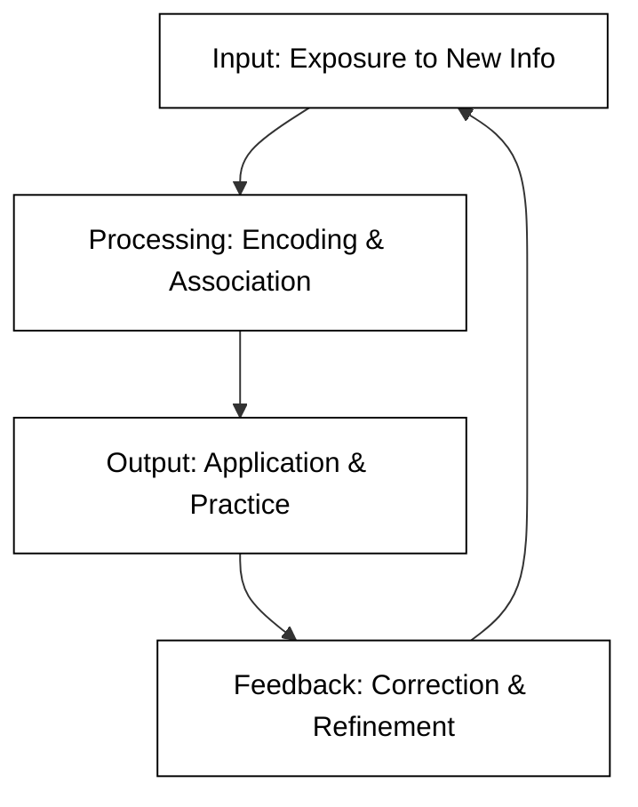

--- 

<iframe src="https://class.cs260.click/#/l" width="100%" height="400"/>

-

```masteryls
{"id":"3797ca50-7b58-414e-a169-1fef15561307","title":"Understanding God's Relentless Pursuit","type":"multiple-choice"}
In the context of spiritual learning and theology, what does the concept of "God is in relentless pursuit of you" primarily signify?

- [ ] It describes a passive observation where God waits for a person to achieve a specific level of holiness before initiating a relationship.
  I appreciate your effort in thinking about the importance of holiness! However, this choice suggests that the relationship is dependent on our own initial perfection. The core of "relentless pursuit" is that God is the **active initiator**. The correct answer is that it is a proactive, persistent initiative by God to reach out to individuals regardless of their current state or past mistakes.
- [x] It represents a proactive, persistent initiative by God to seek out and restore a relationship with individuals, regardless of their distance or rebellion.
  You nailed it! This answer correctly identifies that "relentless pursuit" means God's love is active and intentional. It highlights that He doesn't wait for us to become perfect or find our own way back; instead, He actively seeks us out—much like the shepherd searching for the lost sheep—to offer grace and reconciliation.
- [ ] It is a conditional effort that ceases if a person continues to ignore spiritual prompts for an extended period of time.
  That is a thoughtful perspective on human choice, but the term "relentless" specifically implies that God's effort does not have an expiration date. While we have the will to respond, the concept emphasizes His unwavering commitment. The correct answer is that it is a proactive, persistent initiative by God to restore a relationship, showing that His grace is more stubborn than our avoidance.
- [ ] It refers to a reward system where God's closeness is only granted to those who have successfully completed a spiritual journey.
  It is great that you are thinking about the journey of faith! However, the concept of pursuit implies that God is moving toward us while we are still on the way (or even lost). It isn't a reward for finishing; it is the means by which we are found. The correct answer is that it is a proactive and persistent initiative by God to reach us, demonstrating that His pursuit precedes our progress.
```

# Learning

This course is used to experiment while MasteryLS is being developed.


## The Architecture of Learning

Learning is not a static event but a dynamic process of constructing knowledge. Just as a home requires a solid foundation, a frame, and finishing touches, the process of acquiring new skills involves building mental models that allow us to interpret the world. At its core, learning is about neuroplasticity—the brain's ability to reorganize itself by forming new neural connections in response to experience and practice.

To learn effectively, one must move beyond passive consumption (like reading a book or watching a video) and engage in active construction. This involves synthesizing new information with what you already know, a process known as *elaboration*. By connecting new concepts to existing "mental hooks," you ensure that the information is stored in long-term memory rather than being lost to the "forgetting curve."

### The Cycle of Knowledge Acquisition

Effective learning follows a cyclical pattern of input, application, and refinement. The following diagram illustrates how information moves from initial exposure to mastery:



### Core Pillars of Effective Learning

To optimize your study habits, consider these four evidence-based strategies:

1.  **Active Recall:** Testing yourself instead of just re-reading notes. This forces the brain to retrieve information, strengthening the neural pathway.
2.  **Spaced Repetition:** Reviewing material at increasing intervals over time to combat the forgetting curve.
3.  **Interleaving:** Mixing different topics or types of problems within a single study session to improve problem-solving flexibility.
4.  **Dual Coding:** Combining verbal materials with visual imagery to provide two different ways of representing the same information.


```masteryls
{"id":"299edd23-220e-4b3f-9aed-c05a278923e8","title":"Understanding Active Recall","type":"multiple-choice"}
Which of the following activities best demonstrates the principle of "Active Recall"?

- [ ] Highlighting key passages in a textbook while reading for the first time.
  Highlighting can help identify important information, but it is primarily a **passive study strategy**. Active recall requires retrieving information from memory rather than simply marking it while reading.
- [ ] Listening to a recorded lecture while commuting to work or school.
  Listening to a lecture may provide useful exposure to new information, but it does not require you to **retrieve knowledge from memory**. This activity supports input, not active recall.
- [x] Closing your book and writing down everything you remember about a topic from memory.
  **Correct!** Closing the book and recalling information forces your brain to retrieve what you have learned. This strengthens neural pathways and helps move knowledge into long-term memory.
- [ ] Reading a chapter three times in a row to ensure the information "sinks in."
  Repeated reading may create a sense of familiarity, but it does not actively test your ability to remember the material. **Retrieving information without looking at the text** is more effective for strengthening learning.
```

## Outcomes

By the end of the course you should have experienced the following outcomes.

- **Metacognitive Strategy Application**: Identify and apply evidence-based study techniques, including active recall and spaced repetition, to enhance long-term retention.
- **Cognitive Process Analysis**: Explain the biological foundations of learning, such as neuroplasticity and encoding, and their impact on knowledge acquisition.
- **Information Synthesis**: Utilize dual coding and elaboration to integrate new information into existing mental frameworks.
- **Reflective Practice**: Evaluate personal learning workflows and iterate on study habits to optimize academic and professional performance.