# Images

This is a demo of generating images with AI.

## WebSocket communication intialization and passing of data

### Visual

#### V1

#### V2

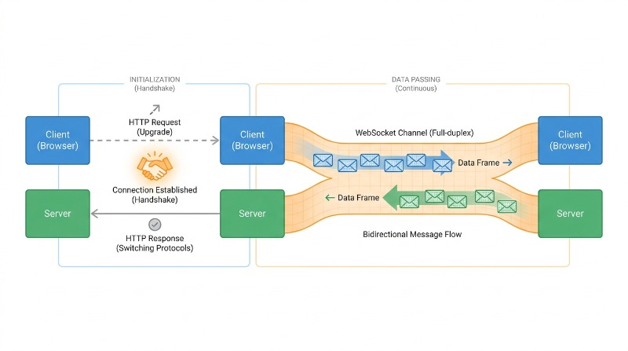

#### V3

#### V5

_Same prompt. Totally different results_

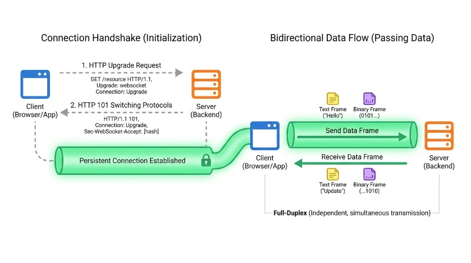

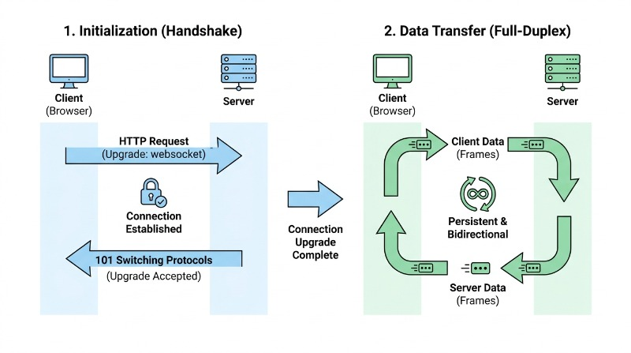

### Photo

### Watercolor

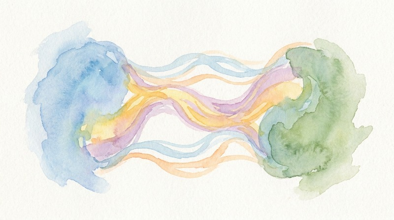

### Line art

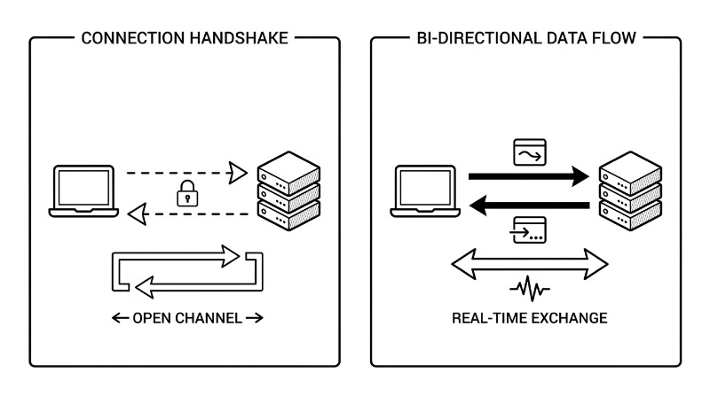

### 3D Render

## The glory of God is intelligence

### photo

### Visual

#### V1

#### V3

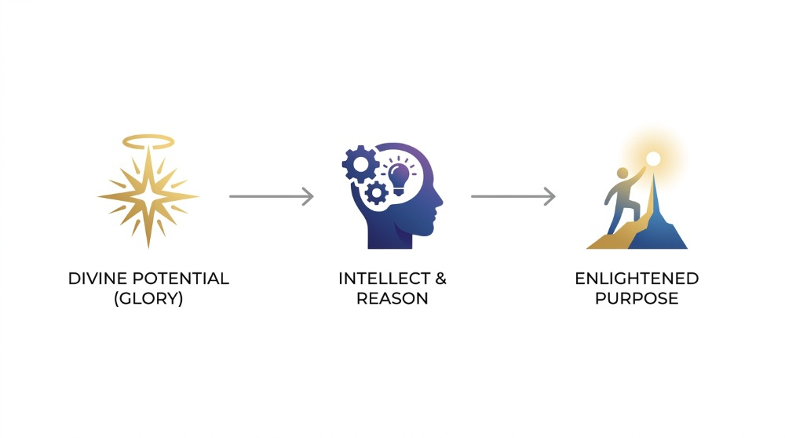

#### V5

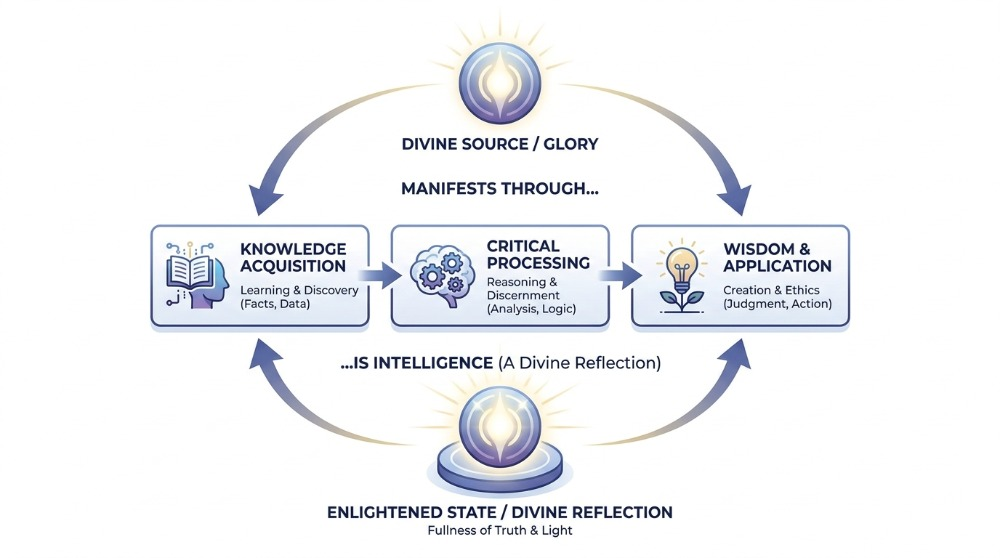
### Minimalist

### 3D render

### Line Art

### Water color

## female university student in class asking a question

### photo

### Visual

#### V1

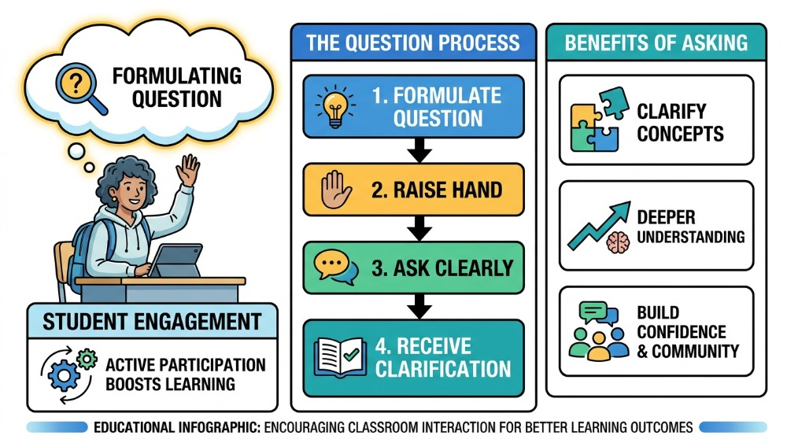

#### V3

#### V4
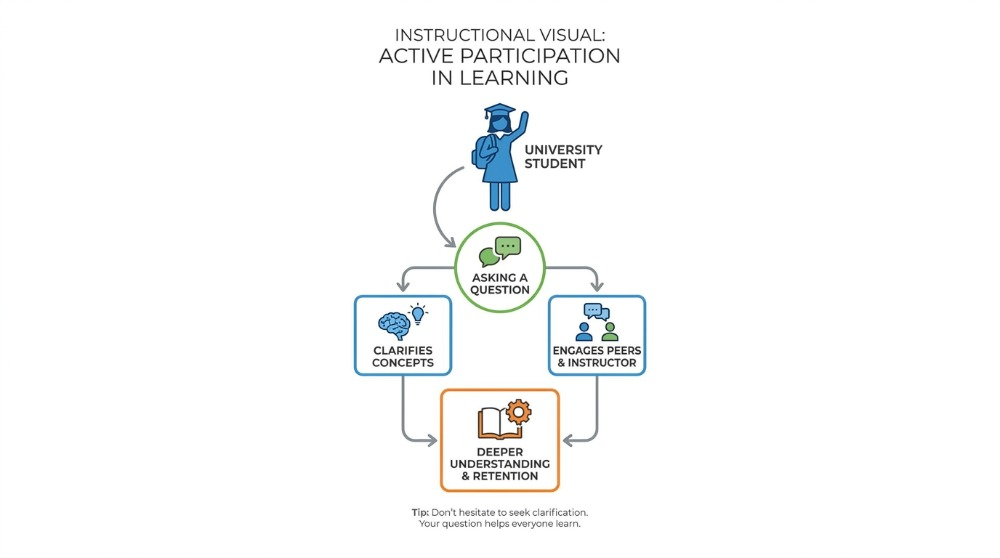

#### V5

_Same prompt. Totally different results_

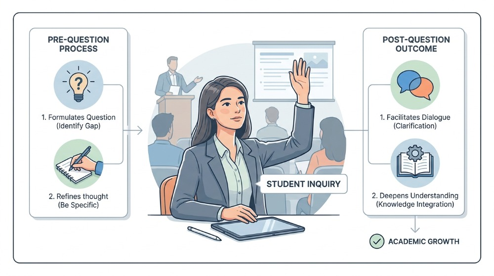

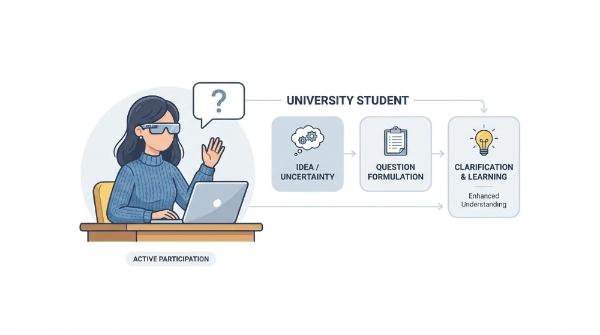

### Minimalist

### 3D render

### Line Art

### Water color

