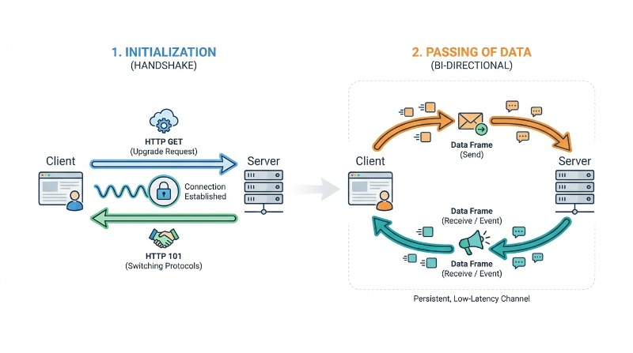
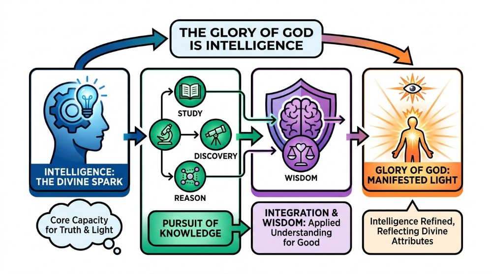
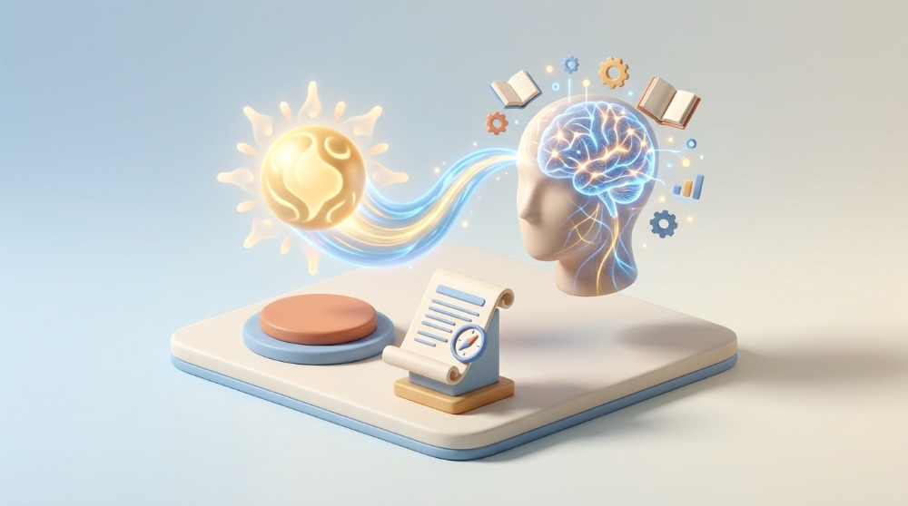
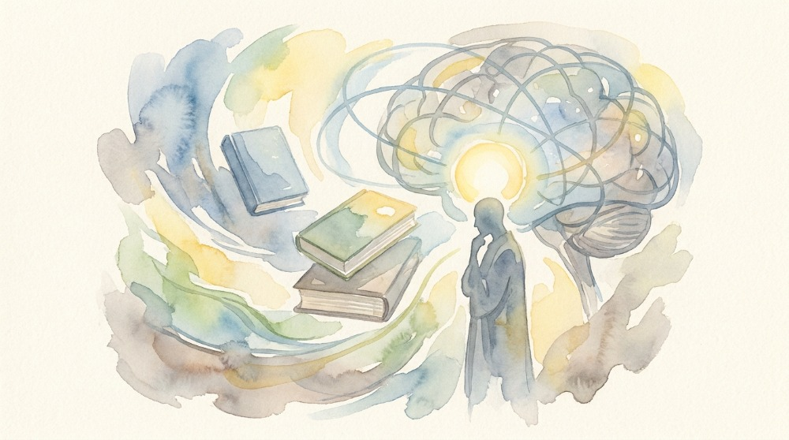
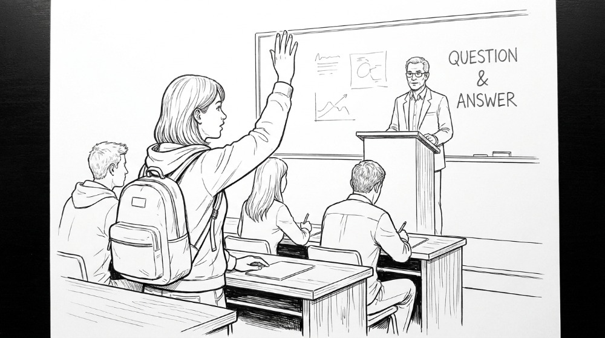

# Images

This is a demo of generating images with AI.

## WebSocket communication intialization and passing of data

## The glory of God is intelligence

### photo

### Visual

### Minimalist

### 3D render

### Line Art

### Water color

## female university student in class asking a question

### photo

### Visual

### Minimalist

### 3D render

### Line Art

### Water color

